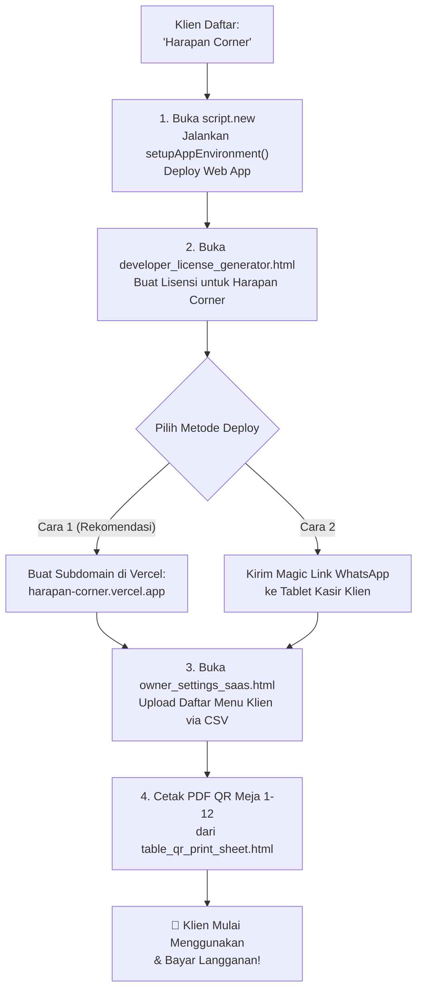

# 📘 PANDUAN LENGKAP: CARA MENDUPLIKAT RESTO PRO UNTUK KLIEN BARU
## Studi Kasus Nyata: Klien "Harapan Corner" ✨

Dokumen ini menjelaskan secara gamblang bagaimana cara kerja aplikasi Anda: apa itu **Master**, apa yang terjadi saat ada klien baru (**Harapan Corner**), dan bagaimana cara menduplikasinya dari jarak jauh tanpa membuat data antar restoran saling bercampur.

---

## 🧠 Konsep Dasar: Master vs Klien Baru

Saat ini Anda memiliki:
1. **Master Frontend:** `https://restopro-beta.vercel.app` (Ini adalah etalase / demo resmi Anda).
2. **Master Backend Database:** Google Spreadsheet & Apps Script milik Anda sendiri.

Ketika ada restoran baru bergabung (contoh: **Harapan Corner**), prinsip utamanya adalah:
> **Setiap restoran WAJIB memiliki Google Spreadsheet sendiri.**  
> Tujuannya: Agar data omset uang, resep menu, data pelanggan CRM, dan nomor WA tamu Harapan Corner **tidak pernah bercampur** dengan restoran lain, serta pemilik resto merasa aman 100% karena mereka yang memegang datanya.

---

## 🚀 2 Cara Menduplikat untuk "Harapan Corner"

Pilihlah salah satu cara yang paling sesuai dengan kebutuhan Anda:

---

### CARA 1 (SANGAT DIREKOMENDASIKAN): Domain Khusus Klien di Vercel
*(Contoh: `https://harapan-corner.vercel.app`)*

Cara ini paling disukai pemilik resto karena mereka merasa memiliki aplikasi kasir eksklusif dengan nama restoran mereka sendiri. Anda bisa mengenakan biaya setup lebih tinggi!

#### Langkah 1: Buat Database Google Sheets Baru untuk Harapan Corner (3 Menit)
1. Buka browser: **[script.new](https://script.new)**.
2. Beri nama proyek di kiri atas: `Backend Harapan Corner`.
3. Buka file `backend/Kode.gs`, copy seluruh isinya, dan paste ke editor Apps Script.
4. *(Opsional)* Di baris 702, ubah:
   ```javascript
   const APP_NAME = 'Harapan Corner';
   ```
5. Pilih fungsi **`setupAppEnvironment`** lalu klik **Run (Jalankan)** ➔ Berikan izin (Review permissions ➔ Advanced ➔ Allow).
6. Catat **`API SECRET KEY`** baru yang muncul di Execution Log.
7. Klik tombol biru **Deploy** ➔ **New deployment** ➔ Type: **Web app** ➔ Execute as: **Me** ➔ Who has access: **Anyone** ➔ Klik **Deploy**.
8. Salin **Web App URL** Harapan Corner (berakhiran `/exec`).

#### Langkah 2: Buat Cabang (Branch) atau Proyek di Vercel
1. Di laptop Anda, buat branch baru untuk Harapan Corner:
   ```bash
   git checkout -b klien/harapan-corner
   ```
2. Buka file `assets/js/resto-config.js`, masukkan URL dan API Key Harapan Corner yang baru saja dibuat di Langkah 1:
   ```javascript
   const RESTO_CLOUD_CONFIG = {
     GAS_URL: "https://script.google.com/macros/s/AKfycb...URL_HARAPAN_CORNER.../exec",
     API_SECRET_KEY: "RP-SEC-HARAPAN-CORNER",
     ...
   };
   ```
3. Simpan dan push branch tersebut ke GitHub:
   ```bash
   git add assets/js/resto-config.js
   git commit -m "config: setup database cloud untuk Harapan Corner"
   git push -u origin klien/harapan-corner
   ```
4. Buka **[vercel.com](https://vercel.com)**:
   - Klik **Add New... ➔ Project**.
   - Import repository `restopro`.
   - Pada kolom **Project Name**, ubah menjadi: `harapan-corner`.
   - Pada bagian **Git Branch**, pilih: `klien/harapan-corner`.
   - Klik **Deploy**!
5. **Selesai!** Dalam 20 detik, Harapan Corner memiliki web app sendiri:  
   👉 **`https://harapan-corner.vercel.app`**

---

### CARA 2: Tanpa Bikin Web Baru (Pakai 1 Master Vercel + Magic Link)
*(Tetap menggunakan `https://restopro-beta.vercel.app`)*

Jika Anda tidak mau membuat link Vercel baru untuk setiap klien, Anda bisa menggunakan **1 web master saja**. Aplikasi Resto Pro sudah dilengkapi fitur canggih **Magic Auto-Config**:

1. Lakukan **Langkah 1** di atas untuk membuat Google Spreadsheet baru Harapan Corner dan dapatkan URL Web App-nya.
2. Buka Generator Lisensi di master Anda:
   `https://restopro-beta.vercel.app/developer_license_generator.html`
3. Masukkan nama resto: `Harapan Corner`, pilih paket (misal: Trial 14 Hari), klik **Generate Lisensi**.
4. Susun **Magic Onboarding Link** dengan format:
   ```text
   https://restopro-beta.vercel.app/cashier_pos_register.html?setupGasUrl=[URL_GAS_HARAPAN_CORNER]&setupApiKey=[API_KEY]&setupLicense=[KODE_LISENSI]
   ```
5. Kirim link tersebut via WhatsApp ke pemilik Harapan Corner.
6. Saat pemilik Harapan Corner mengklik link tersebut di tablet kasir mereka, sistem Resto Pro **otomatis merekam URL database Harapan Corner ke memori browser mereka** dan menghapus parameter link sehingga rapi dan aman!

---

## 🖨️ Cara Cetak QR Meja untuk Harapan Corner

1. Buka halaman cetak QR di link mereka:
   `https://harapan-corner.vercel.app/table_qr_print_sheet.html`
   *(atau buka di master dengan database yang sudah aktif)*.
2. Klik tombol **Cetak / Simpan PDF**.
3. Kirim file PDF hasil cetak tersebut ke pemilik Harapan Corner untuk dilaminating atau dimasukkan ke akrilik meja nomor 1 sampai 12.
4. Setiap kali tamu Harapan Corner scan QR meja tersebut, pesanan tamu akan **langsung masuk ke dapur dan kasir Harapan Corner**, tanpa mengganggu restoran lain!

---

## 📋 Ringkasan Alur Kerja Menjual ke Klien Baru



---

## 💡 Tips Tambahan untuk Menjual:
- **Paket Coba Gratis (14 Hari):** Berikan lisensi Trial 14 hari dulu agar mereka merasakan mudahnya mencatat pesanan dan melihat lonceng dapur berbunyi.
- **Setelah 14 Hari:** Klien akan terbiasa dan sulit kembali ke pencatatan nota kertas manual. Di titik inilah Anda menawarkan perpanjangan lisensi Pro (Rp 99.000 - Rp 149.000 per bulan).
- **Semua catatan lisensi bisa Anda kontrol sendiri** kapan saja dari generator lisensi!
