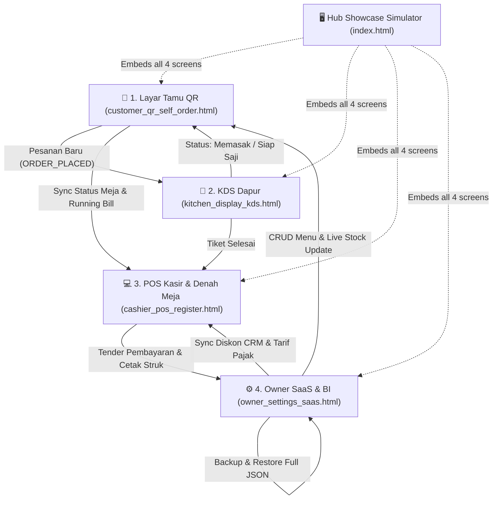

# Resto Pro by RASH WebApp Builder ✨

> **Aplikasi Web POS Restoran, QR Self-Order Tamu, Kitchen Display System (KDS) & SaaS Analytics Terintegrasi**  
> Mengusung spesialisasi kuliner autentik **Timur Tengah (Arabian) 🕌, Malaysia 🇲🇾, Thailand 🇹🇭, serta Minuman Artisan 🍹**.

[](https://github.com/)
[](https://github.com/)
[](https://github.com/)
[](https://github.com/)
[](https://github.com/)
[](https://github.com/)

---

## 🌟 Ikhtisar Ekosistem 4-Layar (Multi-Screen Suite)

Resto Pro dirancang dengan konsep modern *all-in-one touch-friendly* untuk restoran kasual maupun *fine dining*, berjalan 100% di browser tanpa ketergantungan framework berat (*Zero-Build Vanilla JS + Tailwind CSS CDN + BroadcastChannel Sync*).



---

## 🚀 Fitur Unggulan Sistem

### 1. Layar Tamu: QR Self-Order & Booking Meja (`customer_qr_self_order.html`)
- **Dukungan Meja Dinamis:** Scan QR Meja 01 s/d Meja 12 otomatis via parameter URL (contoh: `?table=T07`) atau penggantian meja interaktif.
- **Katalog Menu Fusi 3 Negeri:**
  - *Arabian Delights*: Nasi Mandhi Kambing, Shawarma Ayam, Sambosa Keju.
  - *Malaysian Favorites*: Nasi Lemak Sambal Sotong, Roti Canai Kari, Laksa Penang.
  - *Thai Specialties*: Tom Yum Goong Seafood, Pad Thai Jumbo, Mango Sticky Rice (*Overlay Sold Out*).
  - *Artisan Beverages*: Authentic Teh Tarik, Thai Green Tea, Qahwa Rempah Kapulaga, Jus Kurma Madu.
- **Modifier Modal Interaktif:** Level pedas (0 - 5), porsi nasi (Reguler / Extra), suhu minuman (Panas / Dingin / Normal), dan catatan koki.
- **Sticky Cart & WhatsApp Loyalty Checkout:** Total keranjang dinamis, konfirmasi nama & WhatsApp untuk perolehan poin loyalitas.
- **Reservasi Meja Mandiri:** Formulir booking meja (Indoor AC, Outdoor Garden, VIP Room) untuk acara keluarga atau arisan.
- **Panggil Pelayan:** Tombol *Call Waiter* langsung membunyikan bel di KDS dan Kasir.

### 2. Layar Kasir: Register POS & Denah 12 Meja (`cashier_pos_register.html`)
- **Denah 12 Meja Interaktif:**
  - 🟢 **Kosong (Emerald):** Siap digunakan tamu baru.
  - 🔴 **Terisi (Crimson/Red):** Sedang makan dengan running bill otomatis dari pesanan QR.
  - 🟡 **Minta Bill (Amber Pulse):** Tamu meminta tagihan pembayaran.
  - 🟣 **Booking (Indigo):** Meja dibooking reservasi dengan waktu kedatangan tamu.
- **Filter Denah Meja Cepat:** Filter *Semua (12)*, *Kosong*, *Terisi*, *Bill*, atau *Booking*.
- **Quick-Touch Food Tiles Grid:** Tambah pesanan langsung dari kasir berdasarkan kategori.
- **CRM Member Kasir:** Pencarian otomatis autocomplete nama / nomor WhatsApp, integrasi diskon bertingkat (VIP Gold 10%, VIP Silver 5%, Promo 15%), dan pendaftaran member baru langsung dari kasir.
- **Split Bill Terpadu:** Pembagian tagihan rata (2 hingga 10 orang) seketika.
- **Tender Multi-Pembayaran:**
  - **Tunai / Cash:** Kalkulator nominal cepat (Uang Pas, Rp 50.000, Rp 100.000, Rp 200.000) dan hitung kembalian instan.
  - **QRIS Dinamis:** Mockup QRIS standar Bank Indonesia.
  - **Kartu Debit / EDC:** Integrasi terminal kartu.
- **Cetak Struk Thermal 80mm / 58mm:** Dialog print terformat rapi sesuai standar struk kasir profesional.
- **Riwayat Transaksi Multi-Hari & Z-Report:** Cari transaksi lampau (hari ini, kemarin, 7 hari, custom tanggal), reprint struk, dan ekspor ke Excel/CSV.

### 3. Layar Dapur: Kitchen Display System (`kitchen_display_kds.html`)
- **Real-Time Web Audio Chime:** Lonceng 2-nada otomatis berbunyi tiap pesanan baru masuk tanpa perlu reload.
- **Filter Station:** *Semua Station*, *Dapur Utama*, dan *Bar Minuman*.
- **Timer Waktu Masak Dinamis:** Indikator waktu berjalan per tiket, badge hijau (<10 menit), kuning (<15 menit), dan merah berdenyut (*Overdue >15 menit*).
- **Transisi Status Tiket:** `Pesanan Baru` ➔ `Sedang Dimasak` ➔ `Siap Saji` ➔ `Sajikan / Clear`.

### 4. Layar Owner: Dashboard SaaS & Business Intelligence (`owner_settings_saas.html`)
- **Business Intelligence & Analytics (BI):**
  - **Peak Hours Heatmap:** Grafik batang aktivitas jam sibuk 08:00 – 22:00 WIB.
  - **Top 5 Best-Sellers Leaderboard:** Peringkat hidangan paling diminati.
  - **Pangsa Penjualan Kuliner:** Persentase omset Arabian vs Malaysian vs Thai vs Artisan Drinks.
  - **Distribusi Pembayaran:** Perbandingan Tunai vs QRIS vs Kartu Debit.
  - **AI Smart Insights:** Rekomendasi otomatis stok, promosi jam sepi, dan rekrutmen koki.
- **Buku Kas Multi-Hari & CSV Export:** Laporan omset dengan filter tanggal fleksibel.
- **Katalog Menu Dinamis (CRUD):** Tambah menu baru, ubah harga, hapus, dan toggle stok habis/tersedia dengan sinkronisasi langsung ke QR Tamu.
- **Direktori Member CRM:** Kelola database pelanggan, saldo poin loyalitas, dan status tier.
- **Manajemen Reservasi Meja:** Buku besar reservasi meja dan tombol check-in tamu.
- **Pencadangan & Pemulihan (JSON Backup & Restore):** Unduh database lengkap dalam 1 file JSON, restore instan, dan opsi Reset Demo Pabrik.
- **Backend Google Apps Script & Google Sheets Cloud (Section 7):** Integrasi cloud database ke Google Sheets via REST API Web App (`backend/Kode.gs`). Mendukung sinkronisasi dua arah (*Push & Pull*) serta pencatatan otomatis transaksi, menu, member CRM, dan tiket KDS ke Google Sheets.
- **Konfigurasi Sistem:** Pengaturan PB1 (Pajak Restoran 10%), Service Charge, dan profil printer.

---

## 📂 Struktur Berkas Proyek

```
app resto pro/
├── index.html                    # Hub Showcase Interaktif 4-Layar Simulator
├── customer_qr_self_order.html   # Layar Tamu: QR Self-Order & Reservasi
├── cashier_pos_register.html     # Layar Kasir: Register POS & Denah 12 Meja
├── kitchen_display_kds.html      # Layar Dapur: Kitchen Display System (KDS)
├── owner_settings_saas.html      # Layar Owner: Dashboard SaaS, BI & Backup
├── table_qr_print_sheet.html     # Modul Cetak Stiker & Kartu QR Meja Akrilik
├── developer_license_generator.html # Portal Developer: Generator Token Lisensi RASH
├── manifest.json                 # Konfigurasi PWA Mobile & Desktop Installable
├── service-worker.js             # PWA Offline Caching Service Worker
├── PANDUAN_PENGGUNA.md           # Panduan Operasional Lengkap Bahasa Indonesia
├── backend/
│   ├── Kode.gs                   # Google Apps Script Production REST API Backend
│   └── PANDUAN_SETUP_GOOGLE_APPS_SCRIPT.md # Panduan Setup 1-Klik Google Sheets Cloud
├── assets/
│   ├── css/
│   │   └── resto-theme.css       # Skema Warna Dual Theme & Styling Thermal Print
│   ├── js/
│   │   ├── resto-config.js       # Konfigurasi Sentral URL & API Secret Key (Auto-Connect)
│   │   ├── resto-data.js         # Master Data Menu, 12 Meja & ThemeManager
│   │   └── resto-sync.js         # Mesin BroadcastChannel, LocalStorage & GAS Sync
│   └── icons/
│       ├── icon-192.svg          # Ikon Aplikasi PWA 192x192
│       └── icon-512.svg          # Ikon Aplikasi PWA 512x512
```

---

## 🛠️ Cara Menjalankan & Menguji Aplikasi

Aplikasi ini berbasis murni web statis dan tidak memerlukan instalasi Node.js, database server, maupun proses *build*.

### Opsi 1: Buka Langsung di Browser
Klik dua kali berkas `index.html` pada browser modern (Google Chrome, Microsoft Edge, Safari, Firefox).

### Opsi 2: Jalankan via Local HTTP Server (Direkomendasikan untuk PWA & Multi-Device)
Jalankan server lokal melalui terminal:
```bash
# Menggunakan Python 3 bawaan:
python3 -m http.server 8080
```
Buka browser dan akses: `http://localhost:8080/index.html`.

### Cara Menguji Simulasi Lintas Layar:
1. Buka `index.html` di browser laptop/komputer.
2. Pada panel atas, tekan tombol **"⚡ Order Meja 08"** atau **"🛎️ Panggil Pelayan"**.
3. Buka tab baru untuk `kitchen_display_kds.html` dan `cashier_pos_register.html`.
4. Anda akan melihat pesanan masuk secara bersamaan, meja kasir terupdate merah, dan suara bel berbunyi secara instan!

---

## 📄 Lisensi & Hak Cipta
Dikembangkan oleh **RASH WebApp Builder ✨**. Lisensi Enterprise aktif hingga **31 Desember 2028**.
Makanan 100% Halal, Bersih, Berkah & Thayyib.
